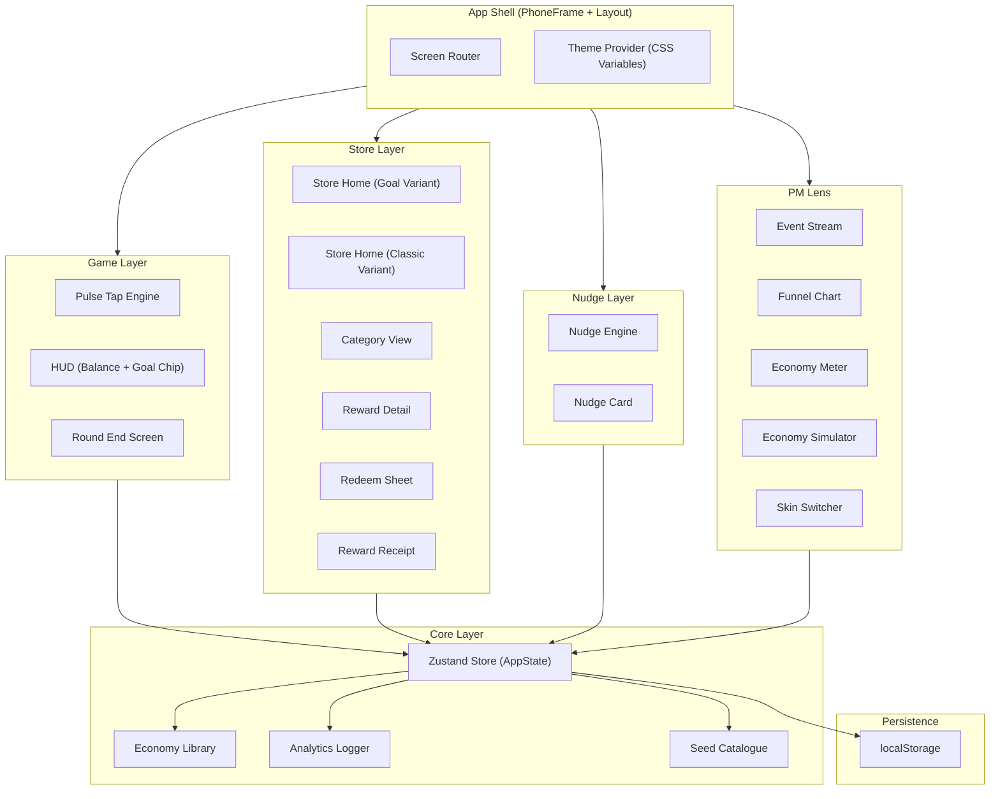
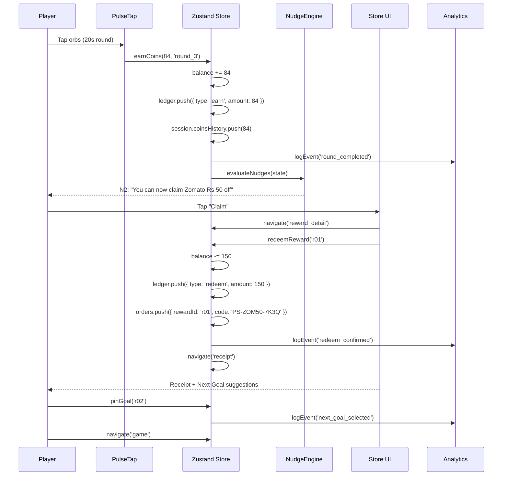
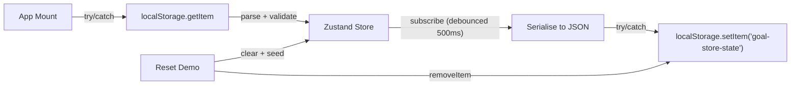
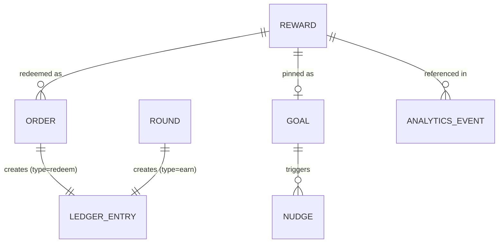
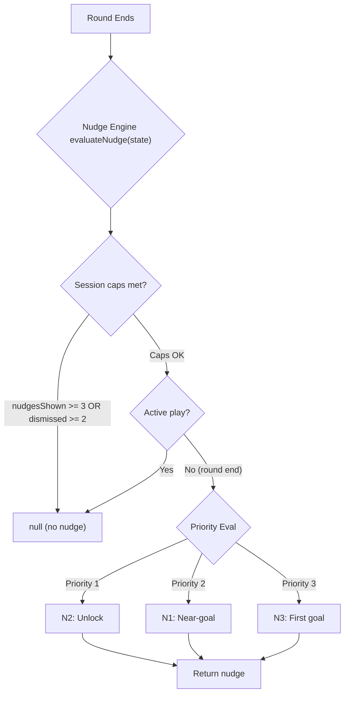
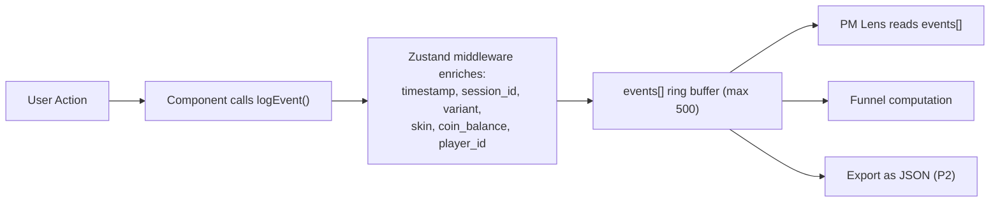
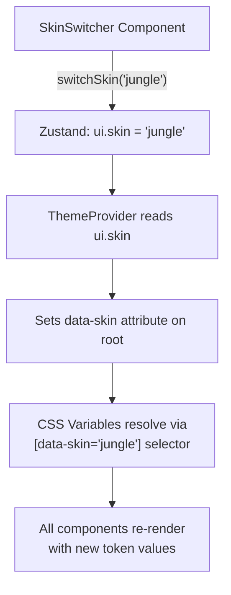
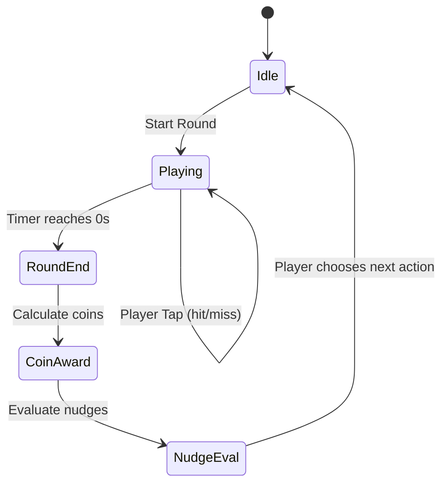
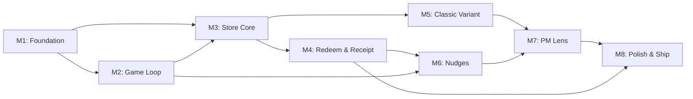

# Architecture: Goal Store

**Technical architecture for the Goal Store interactive prototype**

| | |
|---|---|
| **Author** | Prince Gupta |
| **Status** | v1.0 |
| **Derived from** | `prd.md` v1.0, `problemstatement.md` v1.0 |

---

## 1. Architecture Overview

### 1.1 Design Philosophy

The Goal Store is a **client-side, single-page interactive prototype** — no backend, no authentication, no real payments. Every architectural decision is guided by one constraint: **the store is a moment inside a play loop, not a destination**. This means the system must handle rapid context-switching between game → store → redeem → game without latency, state loss, or cognitive friction.

### 1.2 High-Level System Diagram



### 1.3 Architectural Principles

| # | Principle | Implication |
|---|---|---|
| A1 | **Zero-backend** | All data lives in Zustand + localStorage. No API calls, no auth, no latency. |
| A2 | **Loop-native** | Every screen transition must complete the Game → Store → Redeem → Game loop in < 300 ms. |
| A3 | **Variant-isolated** | Classic and Goal variants share components but diverge at the orchestration layer. Variant selection never mutates wallet state. |
| A4 | **Theme as data** | Skins are CSS variable maps. Switching a skin is a single state update — no component remounts, no layout shift. |
| A5 | **Observable economy** | Every coin movement (earn, spend) is ledger-logged and analytics-emitted. The PM Lens reads the same state the player sees. |
| A6 | **Capped persuasion** | Nudge logic is a pure function of game state with hard caps. No timers, no randomised urgency. |

---

## 2. Technology Stack

| Layer | Technology | Rationale |
|---|---|---|
| **Framework** | React 18+ | Component model, hooks, concurrent features for smooth transitions |
| **Build tool** | Vite | Sub-second HMR, fast cold starts, optimised production bundles |
| **Language** | TypeScript (strict) | Type-safe data model across economy, analytics, and UI |
| **Styling** | Tailwind CSS + CSS custom properties | Utility classes for rapid layout; CSS variables for runtime skin switching |
| **State** | Zustand | Minimal boilerplate, selector-based re-renders, built-in middleware for persistence |
| **Motion** | Framer Motion | Declarative animations for orb pops, progress rings, sheet transitions, success celebrations |
| **Charts** | Recharts | Funnel and economy visualisations in the PM Lens |
| **Persistence** | localStorage (try/catch) | Survives refresh; full reset available |
| **Hosting** | Vercel or Netlify | Static deployment, instant preview URLs |

---

## 3. Component Architecture

### 3.1 Component Hierarchy

```
<App>
├── <ThemeProvider skin={skin}>              // Injects CSS variables
│   ├── <DesktopLayout>                      // Responsive shell
│   │   ├── <BriefPanel />                   // Left: problem context (desktop only)
│   │   ├── <PhoneFrame>                     // Centre: 390×844 viewport
│   │   │   ├── <ScreenRouter>
│   │   │   │   ├── <GameScreen>
│   │   │   │   │   ├── <PulseTap />         // 20s tap game
│   │   │   │   │   ├── <HUD>
│   │   │   │   │   │   ├── <WalletPill />
│   │   │   │   │   │   └── <GoalChip />
│   │   │   │   │   └── <RoundEndSheet />
│   │   │   │   │       └── <NudgeCard />    // Conditional
│   │   │   │   │
│   │   │   │   ├── <StoreScreen>
│   │   │   │   │   ├── <StoreHome>          // Goal variant
│   │   │   │   │   │   ├── <GoalCard />
│   │   │   │   │   │   ├── <RewardRail title="Within Reach" />
│   │   │   │   │   │   ├── <RewardRail title="Quick Wins" />
│   │   │   │   │   │   ├── <CategoryChips />
│   │   │   │   │   │   └── <RewardCard />[]
│   │   │   │   │   ├── <ClassicHome />      // Classic variant
│   │   │   │   │   │   ├── <BannerCarousel />
│   │   │   │   │   │   ├── <CategoryChips />
│   │   │   │   │   │   └── <RewardCard />[] // No ETA, no badges
│   │   │   │   │   └── <CategoryView />
│   │   │   │   │
│   │   │   │   ├── <RewardDetailScreen>
│   │   │   │   │   ├── <RewardDetail />
│   │   │   │   │   ├── <EffortLabel />
│   │   │   │   │   ├── <ProgressBar />
│   │   │   │   │   └── <PinGoalButton />
│   │   │   │   │
│   │   │   │   ├── <RedeemSheet />          // Bottom sheet overlay
│   │   │   │   └── <ReceiptScreen>
│   │   │   │       ├── <ReceiptCard />
│   │   │   │       ├── <NextGoalCard />[]   // 3 suggestions
│   │   │   │       └── <BackToGameCTA />
│   │   │   └── <CoachMark />                // Guided tour overlay
│   │   │
│   │   └── <LensPanel>                      // Right panel / bottom sheet
│   │       ├── <EventStream />
│   │       ├── <FunnelChart />
│   │       ├── <EconomyMeter />
│   │       ├── <SimulatorControls />
│   │       ├── <SkinSwitcher />
│   │       └── <HypothesisCard />
│   └── <LensFAB />                          // Mobile: floating action button
```

### 3.2 Component Responsibilities

| Component | Layer | Reads from State | Writes to State | Key Behaviour |
|---|---|---|---|---|
| `PulseTap` | Game | `session.roundsPlayed` | `balance`, `session.coinsHistory`, `ledger` | Spawns orbs on interval; tracks hits + combo; awards coins via economy formula |
| `HUD` | Game | `balance`, `goalId`, goal progress | — | Passive display; re-renders on balance/goal changes |
| `GoalChip` | Game | `goalId`, `balance`, reward `priceCoins` | — | Shows icon, progress bar, remaining coins. Hidden when `goalId === null` |
| `RoundEndSheet` | Game | `session`, `balance`, goal progress | — | Displays coins earned, balance, goal delta; CTAs: Play Again, Open Store |
| `NudgeEngine` | Nudge | Full `AppState` | `session.nudgesShown`, `session.nudgesDismissed`, `events` | Pure function: evaluates N1–N3 priority, enforces caps (1/round, 3/session, 2 dismissals = off) |
| `StoreHome` | Store | `balance`, `goalId`, `rewards`, `orders` | `events` | Renders Goal Card, Within Reach rail (economy.rankWithinReach), Quick Wins rail |
| `RewardDetail` | Store | `balance`, selected `reward`, `goalId` | `goalId`, `events` | Effort ETA, Pin/Unpin, conditional CTA (Redeem vs Earn More) |
| `RedeemSheet` | Store | `balance`, selected `reward` | `balance`, `ledger`, `orders`, `events` | Debits coins, creates ledger entry + order; double-tap guard |
| `ReceiptCard` | Store | Latest `order`, `rewards` | `goalId`, `events` | Reveals code, copy button, next-goal suggestions, Back to Game CTA |
| `LensPanel` | Lens | `events`, `ledger`, `session`, `ui` | `ui.variant`, `ui.skin` | Read-only analytics views + variant/skin controls |
| `EconomyMeter` | Lens | `ledger` | — | Computes earned, spent, sink ratio, avg coins/round, outstanding |
| `SimulatorControls` | Lens | Economy constants | — | Sliders for coins/round, price multiplier, rounds/day; outputs computed live |

### 3.3 Shared UI Primitives

These are **stateless, themeable** components that accept design tokens via CSS variables:

| Primitive | Props | Used By |
|---|---|---|
| `WalletPill` | `balance` | HUD, StoreHome header |
| `ProgressRing` | `current`, `total`, `size` | GoalCard, GoalChip |
| `EffortLabel` | `remaining`, `avgPerRound` | RewardCard, RewardDetail |
| `StateBadge` | `state: 'affordable' | 'within_reach' | 'far'` | RewardCard |
| `CategoryChips` | `categories[]`, `selected`, `onSelect` | StoreHome, ClassicHome |
| `CoachMark` | `target`, `text`, `step` | Guided tour overlay |

---

## 4. State Architecture

### 4.1 Zustand Store Shape

```typescript
// src/state/useAppStore.ts

interface AppState {
  // === Wallet & Economy ===
  balance: number;                    // Current coin balance
  goalId: string | null;              // Pinned reward ID, or null
  ledger: LedgerEntry[];              // Immutable append-only log of all coin movements
  orders: Order[];                    // Completed redemptions

  // === Session ===
  session: {
    id: string;                       // UUID, reset on variant switch or manual reset
    roundsPlayed: number;
    coinsHistory: number[];           // Last N rounds' coin earnings (for rolling avg)
    nudgesShown: number;              // Cap: 3 per session
    nudgesDismissed: number;          // Cap: 2 dismissals → no more nudges
    redemptionsThisSession: string[]; // Reward IDs redeemed (for next-goal exclusion)
  };

  // === UI ===
  ui: {
    screen: Screen;                   // Current screen enum
    variant: 'classic' | 'goal';
    skin: 'neon' | 'jungle' | 'retail';
    lensOpen: boolean;
    tourDone: boolean;
    selectedRewardId: string | null;  // For detail/redeem screens
  };

  // === Analytics ===
  events: AnalyticsEvent[];           // In-memory event log (last 500, ring buffer)

  // === Actions ===
  earnCoins: (amount: number, refId: string) => void;
  redeemReward: (rewardId: string) => LedgerEntry;
  pinGoal: (rewardId: string | null) => void;
  navigate: (screen: Screen) => void;
  logEvent: (event: Omit<AnalyticsEvent, 'timestamp' | 'session_id' | 'variant' | 'skin' | 'coin_balance'>) => void;
  switchVariant: (variant: 'classic' | 'goal') => void;
  switchSkin: (skin: 'neon' | 'jungle' | 'retail') => void;
  resetDemo: () => void;
}
```

### 4.2 State Flow Diagram



### 4.3 Persistence Strategy



**Rules:**
- Persistence is wrapped in `try/catch` at every call site (private browsing, quota exceeded).
- On hydration, validate the stored shape against the current schema version. On mismatch, fall back to seed state.
- `events[]` are **not persisted** (they are session-scoped and can grow large).
- `resetDemo()` clears localStorage and reinitialises from seed data.

### 4.4 Screen Routing

Screens are managed via a `ui.screen` enum in Zustand, not via URL-based routing. This keeps the prototype simple and avoids browser history side effects inside the phone frame.

```typescript
type Screen =
  | 'game'
  | 'round_end'
  | 'store_home'
  | 'category_view'
  | 'reward_detail'
  | 'redeem_sheet'
  | 'receipt';
```

Transitions are driven by `navigate(screen)` actions, which also log the appropriate analytics event.

---

## 5. Data Architecture

### 5.1 Data Model

```typescript
// === Domain Types ===

type RewardCategory = 'Food' | 'Entertainment' | 'Gaming' | 'Shopping' | 'Fashion' | 'Gadgets';
type RewardType = 'coupon' | 'giftcard' | 'digital' | 'physical';

interface Reward {
  id: string;
  brand: string;
  title: string;
  valueInr: number;
  type: RewardType;
  category: RewardCategory;
  priceCoins: number;
  validityDays: number;
  tag?: 'quick_win';
  popularityRank: number;       // 1 = most popular, used in ranking formula
  brandColor: string;           // For monogram tile generation
  terms: string[];
  howToUse: string[];
}

interface LedgerEntry {
  id: string;                   // UUID
  type: 'earn' | 'redeem';
  amount: number;               // Always positive
  ts: number;                   // Unix timestamp ms
  refId?: string;               // Round ID or reward ID
}

interface Order {
  id: string;                   // UUID
  rewardId: string;
  priceCoins: number;
  code: string;                 // Mock code, e.g. "PS-ZOM50-7K3Q"
  ts: number;
}

interface AnalyticsEvent {
  event_name: string;
  timestamp: number;
  player_id: string;            // Fixed for prototype
  session_id: string;
  variant: 'classic' | 'goal';
  skin: 'neon' | 'jungle' | 'retail';
  coin_balance: number;
  source: 'user' | 'simulated';
  [key: string]: unknown;       // Event-specific properties
}
```

### 5.2 Seed Data Strategy

The seed catalogue (14 rewards, defined in `src/lib/seed.ts`) is a **static array** imported at build time. It is never mutated at runtime. Runtime state (balance, orders, ledger) references rewards by `id`.

**Brand monogram generation:** No remote images are loaded. Brand tiles are generated at render time:
```
<div style={{ backgroundColor: reward.brandColor }}>
  {reward.brand.charAt(0).toUpperCase()}
</div>
```

### 5.3 Data Relationships



---

## 6. Economy Engine

The economy engine is a **pure-function library** (`src/lib/economy.ts`) with zero side effects. It receives state as input and returns computed values.

### 6.1 Core Computations

```typescript
// === Coin Award ===
function calculateCoins(hits: number, longestCombo: number): number {
  return Math.min(120, hits * 4 + longestCombo * 2);
}

// === Effort ETA ===
function effortETA(price: number, balance: number, avgPerRound: number): string {
  const remaining = Math.max(0, price - balance);
  if (remaining === 0) return 'Ready to claim';
  const roundsNeeded = Math.ceil(remaining / avgPerRound);
  if (roundsNeeded <= 3) return `about ${roundsNeeded} round${roundsNeeded > 1 ? 's' : ''}`;
  if (roundsNeeded <= 20) return `about ${roundsNeeded} rounds (~${Math.round(roundsNeeded * 0.5)} min)`;
  return `about ${Math.ceil(roundsNeeded / 15)} day(s) at your pace`;
}

// === Rolling Average ===
function avgCoinsPerRound(history: number[], defaultVal: number = 70): number {
  if (history.length === 0) return defaultVal;
  const recent = history.slice(-3);
  return recent.reduce((a, b) => a + b, 0) / recent.length;
}

// === Reward State ===
function rewardState(price: number, balance: number): 'affordable' | 'within_reach' | 'far' {
  if (balance >= price) return 'affordable';
  if (price <= balance * 1.3) return 'within_reach';
  return 'far';
}
```

### 6.2 Ranking Algorithm

```typescript
// === Within-Reach Ranking (§7.1 of PRD) ===
function rankWithinReach(
  rewards: Reward[],
  balance: number,
  goalCategory: RewardCategory | null,
  recentCategories: RewardCategory[]
): Reward[] {
  const eligible = rewards.filter(r => r.priceCoins <= balance * 1.3);

  return eligible
    .map(r => {
      const proximity = 1 - Math.min(1, Math.abs(r.priceCoins - balance) / Math.max(r.priceCoins, balance));
      const categoryAffinity =
        r.category === goalCategory ? 1 :
        recentCategories.includes(r.category) ? 0.5 : 0;
      const popularity = 1 - (r.popularityRank - 1) / (rewards.length - 1);

      return { reward: r, score: 0.5 * proximity + 0.3 * categoryAffinity + 0.2 * popularity };
    })
    .sort((a, b) => b.score - a.score || a.reward.priceCoins - b.reward.priceCoins)
    .map(entry => entry.reward);
}
```

### 6.3 Next-Goal Suggestions

```typescript
// === Next-Goal Suggestions (§7.2 of PRD) ===
function nextGoalSuggestions(
  rewards: Reward[],
  redeemedReward: Reward,
  redeemedIds: string[]
): Reward[] {
  const available = rewards.filter(r => !redeemedIds.includes(r.id));
  const suggestions: Reward[] = [];

  // 1. Same category, one tier up
  const sameCatHigher = available
    .filter(r => r.category === redeemedReward.category && r.priceCoins > redeemedReward.priceCoins)
    .sort((a, b) => a.priceCoins - b.priceCoins);
  if (sameCatHigher.length > 0) suggestions.push(sameCatHigher[0]);

  // 2. Cheapest unredeemed Quick Win or Everyday
  const cheapUnredeemed = available
    .filter(r => r.priceCoins <= 900)
    .sort((a, b) => a.priceCoins - b.priceCoins);
  if (cheapUnredeemed.length > 0 && !suggestions.find(s => s.id === cheapUnredeemed[0].id)) {
    suggestions.push(cheapUnredeemed[0]);
  }

  // 3. An Aspirational reward
  const aspirational = available
    .filter(r => r.priceCoins >= 1000)
    .sort((a, b) => a.priceCoins - b.priceCoins);
  if (aspirational.length > 0 && !suggestions.find(s => s.id === aspirational[0].id)) {
    suggestions.push(aspirational[0]);
  }

  return suggestions.slice(0, 3);
}
```

### 6.4 Simulator Outputs

```typescript
// === Economy Simulator (§6.4 of PRD) ===
interface SimulatorInputs {
  coinsPerRound: number;
  priceMultiplier: number;
  roundsPerDay: number;
}

interface SimulatorOutputs {
  timeToFirstReward: number;     // rounds
  daysToEverydayTier: number;
  dailyEarn: number;             // coins
  sinkRatio: number;             // 0..1
}

function simulate(
  inputs: SimulatorInputs,
  cheapestPrice: number,
  medianEverydayPrice: number,
  totalEarned: number,
  totalSpent: number
): SimulatorOutputs {
  return {
    timeToFirstReward: (cheapestPrice * inputs.priceMultiplier) / inputs.coinsPerRound,
    daysToEverydayTier: (medianEverydayPrice * inputs.priceMultiplier) / (inputs.coinsPerRound * inputs.roundsPerDay),
    dailyEarn: inputs.coinsPerRound * inputs.roundsPerDay,
    sinkRatio: totalEarned > 0 ? totalSpent / totalEarned : 0,
  };
}
```

---

## 7. Nudge Engine

### 7.1 Architecture

The nudge engine is a **stateless evaluator** — a pure function that receives the full app state and returns zero or one nudge to display.



### 7.2 Evaluation Rules

```typescript
interface NudgeResult {
  type: 'N1_near_goal' | 'N2_unlock' | 'N3_first_goal';
  rewardId: string;
  message: string;
  primaryCTA: { label: string; action: () => void };
  secondaryCTA?: { label: string; action: () => void };
}

function evaluateNudge(state: AppState, rewards: Reward[]): NudgeResult | null {
  const { session, balance, goalId } = state;

  // Hard caps
  if (session.nudgesShown >= 3) return null;
  if (session.nudgesDismissed >= 2) return null;

  const avgPerRound = avgCoinsPerRound(session.coinsHistory);

  // Priority 1: N2 — Unlock (balance just crossed a reward price this round)
  const lastEarned = session.coinsHistory[session.coinsHistory.length - 1] ?? 0;
  const previousBalance = balance - lastEarned;
  const newlyAffordable = rewards.find(r =>
    r.priceCoins > previousBalance && r.priceCoins <= balance
  );
  if (newlyAffordable) {
    return {
      type: 'N2_unlock',
      rewardId: newlyAffordable.id,
      message: `You can now claim ${newlyAffordable.brand} ${newlyAffordable.title}`,
      primaryCTA: { label: 'Claim', action: () => {} },
      secondaryCTA: { label: 'Keep playing', action: () => {} },
    };
  }

  // Priority 2: N1 — Near-goal
  if (goalId) {
    const goalReward = rewards.find(r => r.id === goalId);
    if (goalReward) {
      const remaining = goalReward.priceCoins - balance;
      if (remaining > 0 && remaining <= 2 * avgPerRound) {
        return {
          type: 'N1_near_goal',
          rewardId: goalId,
          message: `You're ${remaining} coins from ${goalReward.brand} ${goalReward.title}. One more round?`,
          primaryCTA: { label: 'Play again', action: () => {} },
          secondaryCTA: { label: 'Open store', action: () => {} },
        };
      }
    }
  }

  // Priority 3: N3 — First goal (after round 1 with no goal)
  if (session.roundsPlayed === 1 && !goalId) {
    return {
      type: 'N3_first_goal',
      rewardId: '',
      message: 'Pick your first goal',
      primaryCTA: { label: 'Browse rewards', action: () => {} },
    };
  }

  return null;
}
```

---

## 8. Analytics Pipeline

### 8.1 Event Flow



### 8.2 Event Schema Enforcement

All events are typed via a discriminated union:

```typescript
type AnalyticsEventPayload =
  | { event_name: 'round_started'; round_index: number }
  | { event_name: 'round_completed'; hits: number; longest_combo: number; coins_earned: number; source: 'user' | 'simulated' }
  | { event_name: 'nudge_shown'; nudge_type: string; goal_id: string | null; remaining_coins: number }
  | { event_name: 'nudge_clicked'; nudge_type: string; goal_id: string | null; remaining_coins: number }
  | { event_name: 'nudge_dismissed'; nudge_type: string; goal_id: string | null; remaining_coins: number }
  | { event_name: 'store_opened'; entry_point: 'hud' | 'round_end' | 'nudge' | 'receipt'; has_goal: boolean }
  | { event_name: 'store_closed'; return_to_game: boolean; time_in_store_sec: number }
  | { event_name: 'category_selected'; category: string }
  | { event_name: 'reward_impression'; reward_id: string; rail: string; position: number; state: string }
  | { event_name: 'reward_clicked'; reward_id: string; rail: string; position: number }
  | { event_name: 'pdp_viewed'; reward_id: string; price: number; balance: number; affordable: boolean }
  | { event_name: 'goal_pinned'; reward_id: string; previous_goal_id: string | null }
  | { event_name: 'goal_unpinned'; reward_id: string }
  | { event_name: 'earn_cta_clicked'; reward_id: string; remaining_coins: number; rounds_needed: number }
  | { event_name: 'redeem_initiated'; reward_id: string; price: number }
  | { event_name: 'redeem_confirmed'; reward_id: string; price: number; balance_after: number }
  | { event_name: 'redeem_failed'; reward_id: string; price: number; reason: string }
  | { event_name: 'reward_revealed'; reward_id: string }
  | { event_name: 'coupon_copied'; reward_id: string }
  | { event_name: 'next_goal_selected'; reward_id: string; suggestion_rank: number }
  | { event_name: 'skin_changed'; from: string; to: string }
  | { event_name: 'variant_changed'; from: string; to: string };
```

### 8.3 Funnel Computation

The funnel is computed **live from the in-memory event log**, not from counters:

```typescript
const FUNNEL_STEPS = [
  'store_opened',
  'pdp_viewed',
  'goal_pinned|redeem_initiated',    // Either counts
  'redeem_confirmed',
  'reward_revealed',
  'round_started',                   // Same session = returned to game
] as const;

function computeFunnel(events: AnalyticsEvent[], sessionId: string): FunnelStep[] {
  return FUNNEL_STEPS.map((step, i) => {
    const names = step.split('|');
    const count = events.filter(e =>
      e.session_id === sessionId && names.includes(e.event_name)
    ).length;
    const prevCount = i === 0
      ? count
      : events.filter(e =>
          e.session_id === sessionId &&
          FUNNEL_STEPS[i - 1].split('|').includes(e.event_name)
        ).length;
    return {
      step,
      count,
      conversionRate: prevCount > 0 ? count / prevCount : 0,
    };
  });
}
```

---

## 9. Theming System

### 9.1 Architecture



### 9.2 Token Implementation

```css
/* src/theme/tokens.css */

[data-skin='neon'] {
  --bg: #0B1020;
  --surface: #151B33;
  --primary: #7C5CFF;
  --accent-coin: #FFC933;
  --success: #22D3A0;
  --text: #EAF0FF;
  --muted: #8A94B8;
  --radius: 20px;
  --font-display: 'Sora', sans-serif;
}

[data-skin='jungle'] {
  --bg: #0F2A1D;
  --surface: #173A28;
  --primary: #FF8A3D;
  --accent-coin: #FFE066;
  --success: #7BE495;
  --text: #F1FFF4;
  --muted: #9CC7AA;
  --radius: 28px;
  --font-display: 'Baloo 2', sans-serif;
}

[data-skin='retail'] {
  --bg: #F6F7FB;
  --surface: #FFFFFF;
  --primary: #2563EB;
  --accent-coin: #F59E0B;
  --success: #16A34A;
  --text: #0F172A;
  --muted: #64748B;
  --radius: 8px;
  --font-display: 'Inter', sans-serif;
}
```

### 9.3 Skin-Switch Invariants

- **No layout shift:** All skins share the same spacing, grid, and component dimensions.
- **No component remount:** Only CSS variables change; React tree stays stable.
- **WCAG AA contrast:** All text/background combinations are pre-validated per skin.
- **Body font:** Always Inter, regardless of skin.

---

## 10. Responsive Layout

### 10.1 Breakpoint Strategy

| Viewport | Layout | PhoneFrame | Lens Access |
|---|---|---|---|
| **Desktop (> 1100px)** | Three-column: Brief Panel ∣ PhoneFrame ∣ Lens Panel | Fixed 390×844 centred, with device bezel | Always-visible right panel |
| **Tablet (700–1100px)** | Single-column centred | Fixed 390×844 centred, no bezel | Slide-over triggered by button |
| **Mobile (< 700px)** | Full-bleed | Fills viewport, no frame | Bottom sheet triggered by FAB |

### 10.2 Layout Implementation

```
Desktop (> 1100px):
┌──────────────┬────────────────────┬──────────────┐
│  BriefPanel  │    PhoneFrame      │  LensPanel   │
│  (280px)     │    (390×844)       │  (360px)     │
│              │                    │              │
│  Problem     │  [Game / Store]    │  Events      │
│  context     │                    │  Funnel      │
│              │                    │  Economy     │
│  Demo steps  │                    │  Simulator   │
└──────────────┴────────────────────┴──────────────┘

Tablet (700–1100px):
┌────────────────────────────────────┐
│          PhoneFrame (centred)       │
│            (390×844)               │
│                                    │
│         [Slide-over Lens] ──────►  │
└────────────────────────────────────┘

Mobile (< 700px):
┌────────────────┐
│  Full viewport │
│  [Game/Store]  │
│                │
│         [FAB]  │  ◄── Opens bottom sheet Lens
└────────────────┘
```

---

## 11. Pulse Tap Game Engine

### 11.1 Game Loop Architecture



### 11.2 Orb Spawn System

```typescript
interface Orb {
  id: string;
  x: number;           // 0..340 (play area width)
  y: number;           // 0..460 (play area height)
  radius: number;       // 28..40 px
  spawnedAt: number;    // timestamp
  ttl: number;          // 1100 ms
  tapped: boolean;
}

// Spawn interval: random between 450–800ms
// Max concurrent orbs: ~3 at any time
// Orb lifetime: 1.1s (expired orb resets combo)
// Play area: 340 × 460 inside the phone frame
```

### 11.3 Scoring

```
coins = min(120, hits × 4 + longestCombo × 2)
```

Example: 18 hits, combo 6 → `min(120, 72 + 12)` = 84 coins.

### 11.4 Feedback Matrix

| Event | Visual | Haptic | Audio |
|---|---|---|---|
| Orb hit | Scale pop (1.3× → 1×, 150ms) + particle burst | `navigator.vibrate(50)` | Off by default |
| Orb miss (expired) | Fade out + combo reset flash | — | — |
| Combo milestone (5, 10) | Combo counter pulse | `navigator.vibrate(100)` | — |
| Round end | Balance counter animation (count-up) | — | — |

---

## 12. Folder Structure

```
src/
├── app/                        # Shell and layout
│   ├── App.tsx                 # Root component, ThemeProvider, DesktopLayout
│   ├── PhoneFrame.tsx          # Device frame wrapper
│   ├── ScreenRouter.tsx        # Screen state → component mapping
│   ├── DesktopLayout.tsx       # Three-column responsive layout
│   └── BriefPanel.tsx          # Problem context sidebar (desktop)
│
├── game/                       # Game layer
│   ├── PulseTap.tsx            # Tap game canvas/DOM
│   ├── Orb.tsx                 # Individual orb component
│   ├── HUD.tsx                 # Balance + goal chip overlay
│   ├── GoalChip.tsx            # Pinned goal progress indicator
│   └── RoundEnd.tsx            # Round summary sheet
│
├── store/                      # Store layer
│   ├── StoreHome.tsx           # Goal variant store home
│   ├── ClassicHome.tsx         # Classic variant store home
│   ├── CategoryView.tsx        # Filtered category grid
│   ├── RewardDetail.tsx        # Full reward page
│   ├── RedeemSheet.tsx         # Bottom sheet confirmation
│   └── Receipt.tsx             # Reward receipt + next goals
│
├── nudges/                     # Nudge system
│   ├── NudgeEngine.ts          # Pure evaluation function
│   └── NudgeCard.tsx           # Nudge display component
│
├── lens/                       # PM Lens
│   ├── LensPanel.tsx           # Container panel/sheet
│   ├── EventStream.tsx         # Live event log
│   ├── Funnel.tsx              # Funnel chart (Recharts)
│   ├── EconomyMeter.tsx        # Earn/spend/sink display
│   ├── Simulator.tsx           # Economy simulator with sliders
│   ├── SkinSwitcher.tsx        # Skin toggle
│   └── HypothesisCard.tsx      # Static test hypothesis
│
├── state/                      # State management
│   ├── useAppStore.ts          # Zustand store definition
│   ├── selectors.ts            # Derived state selectors
│   └── types.ts                # State type definitions
│
├── lib/                        # Pure logic libraries
│   ├── economy.ts              # Coin calc, ETA, ranking, simulator
│   ├── analytics.ts            # Event enrichment, funnel computation
│   ├── seed.ts                 # Seed catalogue (14 rewards)
│   └── utils.ts                # UUID generation, formatters
│
├── theme/                      # Theming
│   ├── tokens.css              # Skin CSS variables
│   └── fonts.css               # Google Fonts imports
│
├── components/                 # Shared UI primitives
│   ├── WalletPill.tsx
│   ├── GoalCard.tsx
│   ├── ProgressRing.tsx
│   ├── RewardCard.tsx
│   ├── EffortLabel.tsx
│   ├── StateBadge.tsx
│   ├── CategoryChips.tsx
│   ├── NextGoalCard.tsx
│   ├── CoachMark.tsx
│   └── Button.tsx
│
└── main.tsx                    # Entry point
```

---

## 13. Build Strategy

### 13.1 Milestone Dependency Graph



### 13.2 Milestone Details

| # | Milestone | Key Deliverables | Gate Criteria |
|---|---|---|---|
| **M1** | Foundation | Vite + React + TS + Tailwind scaffold; `tokens.css` with 3 skins; `PhoneFrame`; Zustand store with seed data; analytics logger | Skins switch without layout shift; events appear in console |
| **M2** | Game Loop | `PulseTap` with orb spawning; hit detection + combo tracking; coin award formula; `HUD` with `WalletPill`; `RoundEnd` screen | 20s round awards correct coins; HUD updates live |
| **M3** | Store Core | `StoreHome` with `GoalCard`, Within Reach rail, Quick Wins rail; `CategoryChips` with filter; `RewardDetail` with effort ETA; `PinGoalButton`; `GoalChip` in HUD | Player can pin a goal within 60 seconds of first store visit |
| **M4** | Redeem & Receipt | `RedeemSheet` with balance-after preview; ledger writes; `Order` creation; `ReceiptCard` with code reveal, copy, and 3 next-goal suggestions | Double-tap guard works; next goals exclude already-redeemed |
| **M5** | Classic Variant | `ClassicHome` (banner, grid, no ETA/badges); plain confirmation; variant toggle preserving wallet state | Side-by-side comparison shows all Goal Store features absent in Classic |
| **M6** | Nudges | `NudgeEngine` with N1/N2/N3 priority evaluation; session caps; `NudgeCard` with CTAs | Caps enforced: 1/round, 3/session, 2 dismissals = done |
| **M7** | PM Lens | `EventStream` (last 50, filterable); `FunnelChart`; `EconomyMeter`; `SimulatorControls`; `SkinSwitcher`; `HypothesisCard` | Lens data matches player state in real time |
| **M8** | Polish & Ship | `CoachMark` guided tour; responsive layout validation; a11y audit (44px targets, focus states, reduced motion); deploy to public URL | All P0+P1 criteria pass; no console errors; works on phone + laptop |

---

## 14. Quality & Performance

### 14.1 Performance Targets

| Metric | Target | How |
|---|---|---|
| First load (4G) | < 2 seconds | Code splitting by screen; tree-shaking unused Recharts modules; Vite optimised build |
| Screen transition | < 300 ms | No data fetching; Framer Motion layout animations |
| Skin switch | < 16 ms (1 frame) | CSS variable swap only; no React tree mutations |
| Orb tap response | < 50 ms | Direct DOM manipulation for hit feedback; React state batched |

### 14.2 Accessibility

| Requirement | Implementation |
|---|---|
| Tap targets ≥ 44px | Enforced via Tailwind min-w/min-h utilities |
| Visible focus states | `:focus-visible` ring on all interactive elements |
| Keyboard reachable | Tab order follows visual order; Enter/Space activate buttons |
| Reduced motion | `prefers-reduced-motion: reduce` disables all Framer Motion animations |
| Contrast | WCAG AA validated for all skin × text combinations |

### 14.3 Edge Cases

| Scenario | Expected Behaviour |
|---|---|
| Zero balance | All rewards show "far" badge; no "Redeem" CTAs enabled |
| Exact balance | Reward shows "affordable"; Redeem CTA enabled; balance after = 0 |
| All rewards redeemed | Store shows empty state: "You've claimed everything! Keep playing." |
| localStorage unavailable | App works normally in-session; state not persisted; no errors |
| Variant switch | Wallet + ledger preserved; new session ID; nudge counters reset |
| Demo reset | Full state cleared; seed balance restored; events wiped |

---

## 15. Security & Constraints

| Concern | Mitigation |
|---|---|
| No real payments | Prototype explicitly labelled "Demo economy"; no payment APIs |
| No PII | Fixed `player_id`; no form fields for real user data |
| No remote calls | Zero network requests; all data is local |
| No chance mechanics | No randomised reward values; no spin wheels; no mystery boxes |
| No fake scarcity | No countdown timers; no "only X left" messaging |
| Brand disclaimer | Seed catalogue shows "Brand names are illustrative only" |

---

## 16. Glossary

| Term | Definition |
|---|---|
| **Goal** | A single pinned reward the player is working towards |
| **Effort price** | The number of rounds (or days) required to earn enough coins for a reward |
| **Within reach** | Rewards priced at ≤ 130% of the player's current balance |
| **Quick win** | Rewards tagged `quick_win`, priced at 300 coins or fewer |
| **Sink ratio** | Total coins spent ÷ total coins earned |
| **Nudge** | A capped, contextual prompt shown at round end |
| **Lens** | The PM analytics panel showing events, funnel, and economy data |
| **Skin** | A visual theme applied via CSS custom properties |
| **Ledger** | Append-only log of all coin earn/spend events |
| **Seed** | The initial catalogue and balance state loaded on first run or reset |
