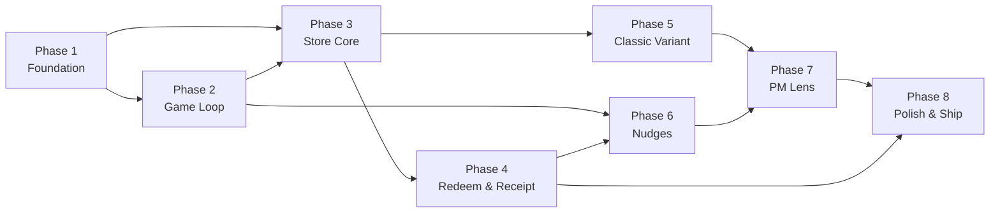

# Implementation Plan: Goal Store

**Phase-wise build plan for the Goal Store interactive prototype**

| | |
|---|---|
| **Author** | Prince Gupta |
| **Status** | v1.0 |
| **Derived from** | `architecture.md` v1.0, `problemstatement.md` v1.0 |

---

## Overview

This plan breaks the Goal Store prototype into **8 sequential phases**, each with concrete tasks, file outputs, acceptance criteria, and estimated effort. Every phase maps directly to a milestone in the architecture document and addresses specific problems from the problem statement.

### Problem → Phase Mapping

| Problem (from `problemstatement.md`) | Addressed In |
|---|---|
| **P1:** Store is a detour from play | Phase 6 (Nudges), Phase 2 (Game loop with store entry) |
| **P2:** Coins without a goal are abstract | Phase 3 (Goal pinning, effort pricing), Phase 2 (HUD) |
| **P3:** Redemption treated as an exit | Phase 4 (Receipt with next-goal loop) |
| **P4:** Economy and rules are invisible | Phase 7 (PM Lens with economy meter and simulator) |

### Phase Dependency Graph



### Effort Summary

| Phase | Name | Estimated Effort | Priority |
|---|---|---|---|
| 1 | Foundation | ~4 hours | P0 |
| 2 | Game Loop | ~6 hours | P0 |
| 3 | Store Core | ~8 hours | P0 |
| 4 | Redeem & Receipt | ~5 hours | P0 |
| 5 | Classic Variant | ~3 hours | P0 |
| 6 | Nudges | ~4 hours | P1 |
| 7 | PM Lens | ~6 hours | P1 |
| 8 | Polish & Ship | ~4 hours | P1 |
| | **Total** | **~40 hours** | |

---

## Phase 1: Foundation

> **Goal:** Scaffold the project, establish the design system, wire up state management and analytics, and render the phone frame shell with skin switching.

### Prerequisites
- Node.js 18+ and npm installed
- Code editor with TypeScript support

### Tasks

| # | Task | Description | Output Files |
|---|---|---|---|
| 1.1 | **Project scaffold** | Initialise Vite + React + TypeScript project. Install dependencies: `tailwindcss`, `zustand`, `framer-motion`, `recharts`. Configure `tsconfig.json` with strict mode. | `package.json`, `vite.config.ts`, `tsconfig.json`, `tailwind.config.ts`, `postcss.config.js` |
| 1.2 | **Tailwind setup** | Configure Tailwind with content paths. Add base layer reset. Set up `index.css` importing Tailwind directives and `tokens.css`. | `src/index.css` |
| 1.3 | **Design tokens** | Create CSS custom property definitions for all 3 skins (Neon Arcade, Jungle Pop, Retail Light). Define `--bg`, `--surface`, `--primary`, `--accent-coin`, `--success`, `--text`, `--muted`, `--radius`, `--font-display`. | `src/theme/tokens.css` |
| 1.4 | **Google Fonts** | Import Inter (body), Sora (Neon display), Baloo 2 (Jungle display) from Google Fonts. | `src/theme/fonts.css` |
| 1.5 | **Type definitions** | Define all TypeScript types: `Reward`, `LedgerEntry`, `Order`, `AnalyticsEvent`, `Screen`, `AppState`, `RewardCategory`, `RewardType`. | `src/state/types.ts` |
| 1.6 | **Seed catalogue** | Create the 14-reward seed array with all properties (id, brand, title, valueInr, type, category, priceCoins, validityDays, tag, popularityRank, brandColor, terms, howToUse). Starting balance: 90 coins. | `src/lib/seed.ts` |
| 1.7 | **Zustand store** | Implement the core Zustand store with initial state from seed, all actions (`earnCoins`, `redeemReward`, `pinGoal`, `navigate`, `logEvent`, `switchVariant`, `switchSkin`, `resetDemo`), and `persist` middleware for localStorage. | `src/state/useAppStore.ts` |
| 1.8 | **Selectors** | Create derived-state selectors: `useGoalReward`, `useAvgCoinsPerRound`, `useRewardState`, `useTotalEarned`, `useTotalSpent`, `useSinkRatio`. | `src/state/selectors.ts` |
| 1.9 | **Analytics logger** | Implement the `logEvent` action that enriches events with common properties (timestamp, session_id, variant, skin, coin_balance, player_id, source) and pushes to the ring buffer (max 500). | `src/lib/analytics.ts` |
| 1.10 | **Utility functions** | UUID generator, coin formatter, code generator (e.g. `PS-ZOM50-7K3Q`). | `src/lib/utils.ts` |
| 1.11 | **PhoneFrame component** | Render a 390×844 phone frame wrapper. On desktop, show a device bezel. On mobile (< 700px), fill the viewport. | `src/app/PhoneFrame.tsx` |
| 1.12 | **ThemeProvider** | Read `ui.skin` from Zustand, set `data-skin` attribute on the root `<div>` so CSS variables resolve correctly. | `src/app/App.tsx` |
| 1.13 | **ScreenRouter** | Map `ui.screen` state to rendered components. Initially render a placeholder for 'game' screen only. | `src/app/ScreenRouter.tsx` |
| 1.14 | **DesktopLayout** | Three-column layout: BriefPanel (left), PhoneFrame (centre), LensPanel placeholder (right). Responsive breakpoints at 700px and 1100px. | `src/app/DesktopLayout.tsx` |
| 1.15 | **BriefPanel** | Static sidebar showing problem statement summary, design pillars, and 60-second demo steps. Desktop only. | `src/app/BriefPanel.tsx` |
| 1.16 | **Entry point** | Wire `main.tsx` to render `<App>` with ThemeProvider and DesktopLayout. | `src/main.tsx` |

### Acceptance Criteria

- [ ] `npm run dev` starts the app without errors
- [ ] PhoneFrame renders at 390×844 centred on desktop
- [ ] All 3 skins switchable via console/devtools (`data-skin` attribute change) — no layout shift
- [ ] Zustand store initialises with seed data (90 coins, 14 rewards)
- [ ] `logEvent` writes to the in-memory events array with enriched properties
- [ ] State persists across page refresh; `resetDemo()` clears and restores seed
- [ ] BriefPanel visible on desktop, hidden below 1100px
- [ ] No TypeScript errors in strict mode

### Scripted Verification
```
1. Run `npm run dev` → app loads in < 2s
2. Open DevTools → Application → localStorage → verify 'goal-store-state' key exists
3. Change `data-skin` attribute on root → colours change, layout stable
4. Call `useAppStore.getState().resetDemo()` → balance resets to 90
```

---

## Phase 2: Game Loop

> **Goal:** Build the Pulse Tap mini-game that awards coins, making the play-to-reward link tangible. Connects gameplay to the economy.

### Dependencies
- Phase 1 complete (store, types, PhoneFrame, tokens)

### Tasks

| # | Task | Description | Output Files |
|---|---|---|---|
| 2.1 | **Economy library** | Implement pure functions: `calculateCoins(hits, longestCombo)`, `effortETA(price, balance, avgPerRound)`, `avgCoinsPerRound(history)`, `rewardState(price, balance)`. | `src/lib/economy.ts` |
| 2.2 | **Orb component** | Render a glowing orb with Framer Motion. Props: `x`, `y`, `radius`, `onTap`, `onExpire`. Animates: spawn (scale 0→1), tap (scale pop 1.3→0 + particle burst), expire (fade out). | `src/game/Orb.tsx` |
| 2.3 | **PulseTap engine** | 20-second game loop. Spawn orbs every 450–800ms at random positions within 340×460 play area. Track `hits`, `misses`, `longestCombo`, `currentCombo`. Orb lifetime: 1.1s. Expired orb resets combo. At timer=0, calculate coins and call `earnCoins()`. | `src/game/PulseTap.tsx` |
| 2.4 | **WalletPill** | Shared component showing coin icon + animated balance counter. | `src/components/WalletPill.tsx` |
| 2.5 | **GoalChip** | HUD element showing pinned goal icon, mini progress bar, remaining coins. Hidden when `goalId === null`. Reads from Zustand. | `src/game/GoalChip.tsx` |
| 2.6 | **HUD** | Overlay on PulseTap: top-left WalletPill, top-right GoalChip, centre countdown timer, combo counter. | `src/game/HUD.tsx` |
| 2.7 | **RoundEnd screen** | Bottom sheet after round ends: coins earned (animated count-up), new balance, goal progress delta (if goal set). CTAs: **Play Again** (starts new round), **Open Store** (navigates to store_home). Both log events. | `src/game/RoundEnd.tsx` |
| 2.8 | **Game screen integration** | Wire ScreenRouter to render GameScreen when `ui.screen === 'game'`. GameScreen hosts PulseTap + HUD, transitions to RoundEnd on round completion. | `src/game/GameScreen.tsx` |
| 2.9 | **Haptic feedback** | Wrap `navigator.vibrate()` in a safe try/catch utility. 50ms on orb hit, 100ms on combo milestone (5, 10). | `src/lib/utils.ts` (update) |
| 2.10 | **Reduced motion** | Respect `prefers-reduced-motion`: disable orb animations, particle bursts, and combo pulses. Still update state. | All game components |

### Acceptance Criteria

- [ ] Round lasts exactly 20 seconds with visible countdown
- [ ] Orbs spawn at random positions every 450–800ms
- [ ] Tapping an orb: scale pop animation + score increment + combo update
- [ ] Expired orb: fade out + combo reset to 0
- [ ] Round end awards `min(120, hits × 4 + longestCombo × 2)` coins → verify: 18 hits, combo 6 = 84 coins
- [ ] HUD shows live balance and goal chip (hidden when no goal)
- [ ] RoundEnd screen shows coins earned, new balance, both CTAs functional
- [ ] `round_started` and `round_completed` events logged with correct properties
- [ ] Ledger has a new `earn` entry after each round
- [ ] Balance persists across page refresh

### Scripted Verification
```
1. Start a round → timer counts from 20 to 0
2. Tap orbs → score increments, combo builds
3. Let an orb expire → combo resets
4. Round ends → coins awarded: verify formula
5. Tap "Play Again" → new round starts
6. Tap "Open Store" → screen changes to store_home (placeholder OK)
7. Check events array → round_started, round_completed present
8. Check ledger → earn entry with correct amount
```

---

## Phase 3: Store Core

> **Goal:** Build the Goal variant store with effort pricing, goal pinning, and the HUD chip — addressing Problem P2 (coins without a goal are abstract).

### Dependencies
- Phase 1 complete (store, types, seed data)
- Phase 2 complete (economy library, WalletPill, GoalChip)

### Tasks

| # | Task | Description | Output Files |
|---|---|---|---|
| 3.1 | **Ranking algorithm** | Implement `rankWithinReach(rewards, balance, goalCategory, recentCategories)` using the score formula: `0.5 × proximity + 0.3 × categoryAffinity + 0.2 × popularity`. Eligible: `price ≤ 1.3 × balance`. | `src/lib/economy.ts` (update) |
| 3.2 | **ProgressRing** | SVG circular progress indicator. Props: `current`, `total`, `size`, `strokeWidth`. Animated via Framer Motion. | `src/components/ProgressRing.tsx` |
| 3.3 | **EffortLabel** | Displays effort ETA string from `effortETA()`. Shows "Ready to claim", "about N round(s)", "about N rounds (~M min)", or "about N day(s) at your pace". | `src/components/EffortLabel.tsx` |
| 3.4 | **StateBadge** | Pill-shaped badge: "Affordable" (success colour), "Within reach" (primary colour), "Far" (muted colour). | `src/components/StateBadge.tsx` |
| 3.5 | **GoalCard** | Full-width card at top of Store Home. Shows: reward brand tile (monogram), title, coin price, progress ring, remaining coins, effort ETA. Empty state: "Pick a goal to play towards". | `src/components/GoalCard.tsx` |
| 3.6 | **RewardCard** | Card for reward grid/rail. Shows: brand monogram tile, title, coin price, effort ETA (Goal variant only), state badge (Goal variant only). Tappable → navigates to reward_detail. | `src/components/RewardCard.tsx` |
| 3.7 | **CategoryChips** | Horizontal scrollable chip bar: All, Food, Entertainment, Gaming, Shopping, Fashion, Gadgets. Selection filters the grid and logs `category_selected`. | `src/components/CategoryChips.tsx` |
| 3.8 | **StoreHome (Goal variant)** | Full store home screen: header with WalletPill and close button, GoalCard, "Within Reach" rail (ranked rewards), "Quick Wins" rail (tagged rewards, first rail for 0 redemptions), category chips + filtered grid. | `src/store/StoreHome.tsx` |
| 3.9 | **RewardDetail** | Full reward detail page: brand monogram, title, ₹ value, coin price, type, validity, collapsible terms, effort line, progress bar (balance vs price). Primary CTA: **Redeem** (if affordable) or **Earn X more (about N rounds)** (if not). **Pin as goal / Unpin** button. | `src/store/RewardDetail.tsx` |
| 3.10 | **"Earn more" CTA** | When tapped: close store, start a new game round. Log `earn_cta_clicked` with `remaining_coins` and `rounds_needed`. | `src/store/RewardDetail.tsx` (update) |
| 3.11 | **Pin goal action** | Pinning replaces any existing goal. Log `goal_pinned` with `previous_goal_id`. Unpinning logs `goal_unpinned`. GoalChip in HUD updates immediately. | `src/state/useAppStore.ts` (update) |
| 3.12 | **Store navigation events** | Log `store_opened` (with entry_point, has_goal), `store_closed` (with return_to_game, time_in_store_sec), `reward_impression`, `reward_clicked`, `pdp_viewed`, `category_selected`. | Various store components |
| 3.13 | **Screen router updates** | Add `store_home`, `category_view`, `reward_detail` to ScreenRouter. | `src/app/ScreenRouter.tsx` (update) |
| 3.14 | **Button component** | Shared primary/secondary button with loading state, disabled state, size variants. 44px min tap target. | `src/components/Button.tsx` |

### Acceptance Criteria

- [ ] Store Home renders with GoalCard (empty state initially), Within Reach rail, Quick Wins rail
- [ ] Category chips filter the reward grid correctly
- [ ] Within Reach rail sorted by ranking formula (proximity 50%, affinity 30%, popularity 20%)
- [ ] Quick Wins rail shows rewards tagged `quick_win` (≤ 300 coins)
- [ ] Quick Wins rail is first rail when player has 0 redemptions
- [ ] RewardDetail shows all fields: brand, title, ₹ value, coins, type, validity, terms, effort ETA
- [ ] Effort ETA matches formula: e.g. with 90 coins balance and 250 coin reward, avg 70/round → remaining 160, rounds_needed = 3 → "about 3 rounds"
- [ ] "Earn X more" CTA closes store and starts a round
- [ ] Pin as goal updates GoalCard and HUD GoalChip instantly
- [ ] Pinning a new goal replaces the previous one; `goal_pinned` event has `previous_goal_id`
- [ ] All analytics events fire with correct properties
- [ ] Player can pin a goal within 60 seconds of first store visit

### Scripted Verification
```
1. Open store → Store Home renders with empty GoalCard
2. Tap a Quick Win reward → RewardDetail opens
3. Verify effort line: "about N rounds"
4. Tap "Pin as goal" → GoalCard updates, HUD chip appears
5. Go back to store → GoalCard shows pinned reward with progress
6. Tap a category chip → grid filters
7. Tap "Earn X more" → store closes, round starts
8. After round, open store → progress updated on GoalCard
```

---

## Phase 4: Redeem & Receipt

> **Goal:** Build the one-tap redeem flow and the retention-driving receipt screen — addressing Problem P3 (redemption is treated as an exit).

### Dependencies
- Phase 3 complete (RewardDetail, store navigation, goal pinning)

### Tasks

| # | Task | Description | Output Files |
|---|---|---|---|
| 4.1 | **RedeemSheet** | Bottom sheet overlay showing: reward summary, coin price, **balance after** (balance minus price), single **Confirm** button. For physical rewards: "Delivery details (coming soon)" placeholder. | `src/store/RedeemSheet.tsx` |
| 4.2 | **Double-tap guard** | Disable the Confirm button on first tap. Use a `isProcessing` ref to prevent duplicate orders. Only one order and one ledger debit per redeem action. | `src/store/RedeemSheet.tsx` (update) |
| 4.3 | **Redeem action** | `redeemReward(rewardId)`: debit coins from balance, push `redeem` entry to ledger, create `Order` with mock code (e.g. `PS-ZOM50-7K3Q`), add rewardId to `session.redemptionsThisSession`, log `redeem_confirmed`. | `src/state/useAppStore.ts` (update) |
| 4.4 | **Next-goal suggestions** | Implement `nextGoalSuggestions(rewards, redeemedReward, redeemedIds)`: (1) same category one tier up, (2) cheapest unredeemed Quick Win/Everyday, (3) an Aspirational reward. Exclude already-redeemed this session. Max 3 suggestions. | `src/lib/economy.ts` (update) |
| 4.5 | **NextGoalCard** | Card component for each suggestion: brand monogram, title, coin price, effort ETA. One-tap pins as goal and logs `next_goal_selected` with `suggestion_rank`. | `src/components/NextGoalCard.tsx` |
| 4.6 | **ReceiptCard** | Success animation (Framer Motion: confetti/burst), tap-to-reveal code area, copy button (logs `coupon_copied`), how-to-use steps, expiry, coins spent. | `src/store/Receipt.tsx` |
| 4.7 | **Receipt screen** | Full screen: ReceiptCard, heading "What are you playing for next?", 3 NextGoalCards, primary **Back to game** CTA. Tapping Back to game navigates to `game` screen and logs appropriate events. | `src/store/Receipt.tsx` (update) |
| 4.8 | **Code generation** | Generate mock coupon codes in format `PS-{BRAND3}{VALUE}-{4ALPHANUM}` (e.g. `PS-ZOM50-7K3Q`). | `src/lib/utils.ts` (update) |
| 4.9 | **Screen router updates** | Add `redeem_sheet` and `receipt` to ScreenRouter. | `src/app/ScreenRouter.tsx` (update) |
| 4.10 | **Redeem flow integration** | Wire RewardDetail "Redeem" CTA → RedeemSheet → Confirm → Receipt. Ensure the full flow works end-to-end. | Multiple files |

### Acceptance Criteria

- [ ] RedeemSheet shows reward, price, and correct "balance after" value
- [ ] Confirm button debits coins: `balance_after = balance - price`
- [ ] Double-tap on Confirm creates exactly one order and one ledger entry
- [ ] Ledger entry: `{ type: 'redeem', amount: price, refId: rewardId }`
- [ ] Receipt shows success animation and tap-to-reveal code
- [ ] Copy button copies code to clipboard and logs `coupon_copied`
- [ ] "What are you playing for next?" section shows exactly 3 suggestions (or fewer if catalogue is exhausted)
- [ ] Suggestions follow the algorithm: (1) same category higher tier, (2) cheapest unredeemed ≤ 900, (3) aspirational ≥ 1000
- [ ] Suggestions exclude rewards already redeemed this session
- [ ] Tapping a suggestion pins it as goal and logs `next_goal_selected`
- [ ] "Back to game" navigates to game screen; HUD shows new goal chip
- [ ] `redeem_initiated`, `redeem_confirmed`, `reward_revealed` events logged
- [ ] Physical reward shows "Delivery details (coming soon)" but still allows confirm

### Scripted Verification
```
1. With sufficient balance, open RewardDetail → tap "Redeem"
2. RedeemSheet shows → verify balance after is correct
3. Tap "Confirm" → Receipt appears with animation
4. Tap code area → code revealed
5. Tap copy → verify clipboard + coupon_copied event
6. Verify 3 next-goal suggestions appear
7. Tap a suggestion → goal pinned, next_goal_selected logged
8. Tap "Back to game" → game screen, HUD shows new goal
9. Double-tap test: rapidly tap Confirm → only 1 order in state
10. Redeem Zomato Rs 50 (r01) → suggestions should NOT include r01
```

---

## Phase 5: Classic Variant

> **Goal:** Build the control variant (traditional catalogue store) so the difference with the Goal Store is visible side-by-side — answering the core question from the problem statement.

### Dependencies
- Phase 3 complete (shared components: RewardCard, CategoryChips, WalletPill)

### Tasks

| # | Task | Description | Output Files |
|---|---|---|---|
| 5.1 | **ClassicHome** | Store home without Goal Store features: static banner carousel, category chips, unsorted reward grid showing coin price only (no effort ETA, no state badges, no Within Reach/Quick Wins rails, no GoalCard). | `src/store/ClassicHome.tsx` |
| 5.2 | **Banner carousel** | Simple auto-scrolling banner component with 2–3 static promotional banners. No interactivity beyond swipe. | `src/store/BannerCarousel.tsx` |
| 5.3 | **Classic product page** | Simplified RewardDetail: brand, title, price, Redeem button. Disabled state reads "Not enough coins" with no "Earn more" CTA. No effort pricing, no pin goal. | `src/store/ClassicRewardDetail.tsx` |
| 5.4 | **Classic confirmation** | Plain confirmation screen with code and **Close** button. No next-goal suggestions, no "back to game" loop. | `src/store/ClassicConfirmation.tsx` |
| 5.5 | **Variant switch** | Implement `switchVariant(variant)` in Zustand: preserves wallet + ledger, generates new session ID, resets nudge counters, logs `variant_changed`. | `src/state/useAppStore.ts` (update) |
| 5.6 | **Variant-aware routing** | ScreenRouter checks `ui.variant` to render Goal or Classic components. StoreHome → StoreHome or ClassicHome; RewardDetail → RewardDetail or ClassicRewardDetail; Receipt → Receipt or ClassicConfirmation. | `src/app/ScreenRouter.tsx` (update) |
| 5.7 | **Variant toggle UI** | Toggle button/switch accessible from the store header or settings. Clearly labelled "Goal Store" / "Classic Store". | `src/store/VariantToggle.tsx` |

### Acceptance Criteria

- [ ] Classic store shows: banner carousel, category chips, unsorted flat grid with coin prices only
- [ ] No GoalCard, no effort ETA, no state badges, no nudges visible in Classic
- [ ] Classic product page shows "Not enough coins" when balance < price (no earn CTA)
- [ ] Classic confirmation shows code + Close button only (no next-goal suggestions)
- [ ] Variant switch preserves wallet balance and ledger
- [ ] Variant switch creates a new session ID
- [ ] `variant_changed` event logged with `from` and `to`
- [ ] Switching back to Goal variant shows GoalCard, effort pricing, badges

### Scripted Verification
```
1. Play rounds, accumulate coins
2. Open Goal Store → verify GoalCard, ETA, badges present
3. Toggle to Classic → verify GoalCard absent, no ETA, no badges, unsorted grid
4. Verify balance is unchanged after switch
5. Redeem in Classic → plain confirmation, no next-goal
6. Toggle back to Goal → GoalCard reappears, effort pricing shows
7. Check events → variant_changed logged with correct from/to
```

---

## Phase 6: Nudges

> **Goal:** Build capped, contextual prompts that bridge the gap between gameplay and the store — addressing Problem P1 (store is a detour).

### Dependencies
- Phase 2 complete (RoundEnd screen, game loop)
- Phase 4 complete (redeem flow for N2 unlock nudge)

### Tasks

| # | Task | Description | Output Files |
|---|---|---|---|
| 6.1 | **NudgeEngine** | Pure function `evaluateNudge(state, rewards)` implementing the priority chain: (1) N2 Unlock — balance crossed a reward price this round, (2) N1 Near-goal — remaining ≤ 2× avg/round, (3) N3 First goal — round 1 with no goal. Returns `NudgeResult | null`. | `src/nudges/NudgeEngine.ts` |
| 6.2 | **Session caps** | Enforce: max 1 nudge per round end, max 3 nudges per session, after 2 dismissals no more nudges for the session. | `src/nudges/NudgeEngine.ts` (update) |
| 6.3 | **NudgeCard** | Card component with: message text, primary CTA button, optional secondary CTA, dismiss action (X button). Styled with skin tokens. Animated entrance (slide up from bottom). | `src/nudges/NudgeCard.tsx` |
| 6.4 | **N1 Near-goal nudge** | Message: "You're X coins from {brand} {title}. One more round?" Primary: **Play again** (starts round). Secondary: **Open store**. | `src/nudges/NudgeCard.tsx` (config) |
| 6.5 | **N2 Unlock nudge** | Message: "You can now claim {brand} {title}". Primary: **Claim** (opens RewardDetail). Secondary: **Keep playing**. | `src/nudges/NudgeCard.tsx` (config) |
| 6.6 | **N3 First-goal nudge** | Message: "Pick your first goal". Primary: **Browse rewards** (opens Store Home on Quick Wins). No secondary. | `src/nudges/NudgeCard.tsx` (config) |
| 6.7 | **RoundEnd integration** | After round ends and RoundEnd renders, call `evaluateNudge()`. If a nudge is returned, render NudgeCard within the RoundEnd sheet. | `src/game/RoundEnd.tsx` (update) |
| 6.8 | **Nudge analytics** | Log `nudge_shown`, `nudge_clicked`, `nudge_dismissed` with properties: `nudge_type`, `goal_id`, `remaining_coins`. | `src/nudges/NudgeCard.tsx` (update) |
| 6.9 | **Variant guard** | Nudges only appear in the Goal variant. Classic variant never shows nudges. | `src/nudges/NudgeEngine.ts` (update) |
| 6.10 | **Safety rules** | Never show nudges during active play (only at round end). No countdown timers. No false scarcity. | `src/nudges/NudgeEngine.ts` (verify) |

### Acceptance Criteria

- [ ] After round 1 with no goal: N3 nudge appears ("Pick your first goal")
- [ ] When balance crosses a reward price: N2 nudge appears ("You can now claim...")
- [ ] When goal is pinned and remaining ≤ 2× avg/round: N1 nudge appears
- [ ] Only the highest-priority nudge shows (N2 > N1 > N3)
- [ ] Max 1 nudge per round end
- [ ] Max 3 nudges per session — 4th round end shows no nudge
- [ ] Dismissing 2 nudges → no more nudges for the rest of the session
- [ ] Nudges never appear during active gameplay (only on RoundEnd)
- [ ] Classic variant shows zero nudges
- [ ] `nudge_shown`, `nudge_clicked`, `nudge_dismissed` events logged correctly
- [ ] No countdown timers or fake scarcity in nudge content

### Scripted Verification
```
1. Fresh state → play round 1 → N3 appears ("Pick your first goal")
2. Pin a goal → play rounds → when near goal, N1 appears
3. Play until balance crosses a reward price → N2 appears (takes priority over N1)
4. Dismiss 2 nudges → play another round → no nudge shown
5. Reset → play 4 rounds with nudges showing → after 3rd nudge, no more appear
6. Switch to Classic → play round → no nudge
7. Check events → nudge_shown, nudge_clicked, nudge_dismissed present
```

---

## Phase 7: PM Lens

> **Goal:** Build the analytics panel that makes the economy and experiment design visible — addressing Problem P4 (economy and rules are invisible).

### Dependencies
- Phase 5 complete (variant switch for Lens variant control)
- Phase 6 complete (nudge events for funnel)

### Tasks

| # | Task | Description | Output Files |
|---|---|---|---|
| 7.1 | **LensPanel container** | Responsive container: right panel on desktop (360px), slide-over on tablet, bottom sheet on mobile (triggered by FAB). Scrollable interior with sections. | `src/lens/LensPanel.tsx` |
| 7.2 | **LensFAB** | Floating action button (mobile/tablet only) to toggle the Lens bottom sheet. Icon: analytics/chart symbol. | `src/lens/LensFAB.tsx` |
| 7.3 | **EventStream** | Live scrolling list of last 50 events. Each row: timestamp, event_name, key properties. Filterable by event type (dropdown/chips). Updates in real-time as events are logged. | `src/lens/EventStream.tsx` |
| 7.4 | **EventRow** | Single event row component: icon by type, event name, timestamp, expandable detail showing all properties. | `src/lens/EventRow.tsx` |
| 7.5 | **FunnelChart** | Recharts-based horizontal funnel: Store opened → PDP viewed → Goal pinned / Redeem initiated → Redeemed → Revealed → Returned to game. Shows counts and step conversion rates. | `src/lens/Funnel.tsx` |
| 7.6 | **Funnel computation** | Implement `computeFunnel(events, sessionId)` that processes in-memory events into funnel step counts and conversion rates. | `src/lib/analytics.ts` (update) |
| 7.7 | **EconomyMeter** | Dashboard section showing: total earned, total spent, sink ratio (bar fill), average coins per round, coins outstanding (balance). Colour-coded: sink ratio 40–70% green, outside is amber/red. | `src/lens/EconomyMeter.tsx` |
| 7.8 | **SimulatorControls** | Three sliders: coins per round (10–150, default 70), price multiplier (0.5–3.0, default 1.0), rounds per day (1–50, default 15). Live outputs: time to first reward, days to Everyday tier, daily earn, sink ratio. Healthy band indicators. | `src/lens/Simulator.tsx` |
| 7.9 | **Simulate round** | Button in Lens that adds a set coin amount to balance (simulating a round without playing). Logs `round_completed` with `source = 'simulated'`. | `src/lens/Simulator.tsx` (update) |
| 7.10 | **SkinSwitcher** | Three-option toggle/radio: Neon Arcade, Jungle Pop, Retail Light. Calls `switchSkin()`. Logs `skin_changed`. | `src/lens/SkinSwitcher.tsx` |
| 7.11 | **Variant switch in Lens** | Toggle between Classic and Goal. Calls `switchVariant()`. Logs `variant_changed`. | `src/lens/LensPanel.tsx` (update) |
| 7.12 | **HypothesisCard** | Static card showing: test hypothesis (Goal vs Classic, primary metric D7 retention), guardrails (gameplay minutes, D1 retention, sink ratio, redeem failure, nudge dismissal), sample size calculation. Content from PRD §9. | `src/lens/HypothesisCard.tsx` |
| 7.13 | **"Demo economy" label** | Visible label in Lens and game settings indicating all economy values are for demonstration. | `src/lens/LensPanel.tsx` (update) |

### Acceptance Criteria

- [ ] Lens panel visible on desktop as right column; slide-over on tablet; bottom sheet on mobile via FAB
- [ ] EventStream shows last 50 events, updates in real-time
- [ ] EventStream is filterable by event type
- [ ] FunnelChart renders all 6 steps with correct counts and conversion rates
- [ ] EconomyMeter shows correct earned/spent/sink ratio from ledger data
- [ ] Sink ratio colour-coded: green 40–70%, amber outside
- [ ] Simulator sliders update outputs live
- [ ] Simulator outputs match formulas: timeToFirstReward, daysToEveryday, dailyEarn, sinkRatio
- [ ] "Simulate round" adds coins and logs with `source = 'simulated'`
- [ ] SkinSwitcher changes theme without layout shift; `skin_changed` logged
- [ ] Variant toggle in Lens works; preserves wallet
- [ ] HypothesisCard renders static test design content
- [ ] "Demo economy" label visible

### Scripted Verification
```
1. Desktop: Lens panel visible on right
2. Mobile: tap FAB → bottom sheet opens with Lens
3. Play 2 rounds → EventStream shows round_started, round_completed
4. Filter events by "round_completed" → only round events shown
5. Open store, view reward, pin goal, redeem → funnel updates with each step
6. Check EconomyMeter → earned matches sum of earn ledger entries
7. Adjust simulator slider (coins per round = 100) → time to first reward recalculates
8. Tap "Simulate round" → balance increases, event logged with source=simulated
9. Switch skin → instant visual change, skin_changed event
10. Switch variant → store reloads in new variant, wallet unchanged
```

---

## Phase 8: Polish & Ship

> **Goal:** Final polish pass — guided tour, accessibility audit, responsive validation, edge case handling, and deployment to a public URL.

### Dependencies
- All previous phases complete

### Tasks

| # | Task | Description | Output Files |
|---|---|---|---|
| 8.1 | **CoachMark component** | Spotlight overlay with tooltip. Props: `targetRef`, `text`, `step`, `totalSteps`, `onNext`, `onSkip`. Darkens background around target element, positions tooltip via anchor. | `src/components/CoachMark.tsx` |
| 8.2 | **Guided tour** | 4-step skippable tour: (1) "Play a round to earn coins" → PulseTap, (2) "Pin a reward as your goal" → GoalCard, (3) "See how many rounds it takes" → EffortLabel, (4) "Open the PM Lens to see the data" → LensFAB/LensPanel. Tour state in `ui.tourDone`. | `src/app/GuidedTour.tsx` |
| 8.3 | **Accessibility audit** | Verify and fix: all tap targets ≥ 44px, `:focus-visible` rings on all interactive elements, keyboard tab order follows visual order, `prefers-reduced-motion` disables all animations, WCAG AA contrast in all 3 skins. | All components |
| 8.4 | **Responsive validation** | Test and fix layouts at: 390px (mobile), 768px (tablet), 1200px (desktop), 1440px (wide desktop). Verify PhoneFrame behaviour at each breakpoint. | Layout components |
| 8.5 | **Edge case hardening** | Handle: zero balance (no Redeem CTAs), exact balance (Redeem works, balance after = 0), all rewards redeemed (empty state), localStorage unavailable (no errors), rapid navigation (no broken states). | Various components |
| 8.6 | **Microcopy review** | Verify all microcopy matches PRD §10.4: empty goal, not affordable, near-goal nudge, unlock nudge, redeem success, next goal heading, failure message. | Various components |
| 8.7 | **Wallet history (P2)** | Optional: scrollable list of ledger entries in the store, showing earn/redeem history with timestamps. | `src/store/WalletHistory.tsx` |
| 8.8 | **Reset and export (P2)** | Reset demo button (calls `resetDemo()`). Export events as JSON download. | `src/lens/LensPanel.tsx` (update) |
| 8.9 | **Error boundary** | Wrap the app in a React error boundary that shows a friendly message and a reset button. | `src/app/ErrorBoundary.tsx` |
| 8.10 | **Performance check** | Verify: first load < 2s on throttled 4G, no layout shift on skin switch, no console errors, no React strict mode warnings. | Build output |
| 8.11 | **Brand disclaimer** | Add disclaimer: "Brand names are illustrative only. This is a prototype." Visible in store and settings. | `src/store/StoreHome.tsx` (update) |
| 8.12 | **README** | Setup instructions, tech stack, folder structure overview, assumptions, how to run locally, how to reset. | `README.md` |
| 8.13 | **Production build** | Run `npm run build`, verify no errors. Test the production bundle locally with `npm run preview`. | `dist/` |
| 8.14 | **Deploy** | Deploy to Vercel or Netlify. Verify public URL works on phone (Safari, Chrome) and laptop (Chrome, Firefox). | Public URL |

### Acceptance Criteria

- [ ] Guided tour shows 4 coachmarks in order; skippable; doesn't show again after completion
- [ ] All interactive elements have ≥ 44px tap targets
- [ ] All interactive elements have visible `:focus-visible` states
- [ ] Full keyboard navigation works on desktop
- [ ] `prefers-reduced-motion: reduce` disables all animations
- [ ] WCAG AA contrast passes for all 3 skins (test with axe or Lighthouse)
- [ ] Layouts correct at 390px, 768px, 1200px, 1440px
- [ ] Zero balance: all rewards "far", no Redeem enabled
- [ ] Exact balance: Redeem works, balance after = 0
- [ ] All rewards redeemed: store shows empty state
- [ ] localStorage disabled: app works, no console errors
- [ ] All microcopy matches PRD spec
- [ ] Reset demo restores seed state (90 coins, no orders, no goal)
- [ ] Export events downloads a valid JSON file
- [ ] No console errors in production build
- [ ] First load < 2s on throttled 4G (Lighthouse)
- [ ] Public URL works on mobile + desktop with no sign-in
- [ ] README has setup steps and assumptions

### Scripted Verification (Full Integration)

```
Test 1: First Session Flow
  - Fresh state → play round 1 → N3 nudge appears
  - Tap "Browse rewards" → Store Home opens on Quick Wins
  - Tap Zomato Rs 50 off → RewardDetail opens
  - Tap "Pin as goal" → GoalCard and HUD chip update
  - Close store → play rounds until affordable
  - N2 nudge appears → tap "Claim"
  - Redeem sheet → Confirm → Receipt with 3 next goals
  ✓ Full loop completed

Test 2: Out of Reach
  - 90 coins, open Swiggy Rs 75 off (250 coins)
  - CTA reads "Earn 160 more (about 3 rounds)"
  - Tap → store closes, round starts
  ✓ Effort pricing works

Test 3: Double-Tap Redeem
  - Rapidly tap Confirm twice → exactly 1 order, 1 ledger debit
  ✓ Guard works

Test 4: Nudge Caps
  - Dismiss 2 nudges → play more rounds → no nudges appear
  ✓ Caps enforced

Test 5: Variant Switch
  - Classic: no GoalCard, no ETA, no nudges
  - Goal: GoalCard, ETA, nudges present
  - Wallet unchanged across switch
  ✓ Variants isolated

Test 6: Economy
  - Simulator sliders update outputs
  - Sink ratio = total spent ÷ total earned
  ✓ Economy observable

Test 7: Persistence
  - Refresh page → state preserved
  - Reset demo → seed state restored
  ✓ Persistence works

Test 8: Accessibility
  - Keyboard-only navigation through full flow
  - Screen reader: all interactive elements labelled
  - Reduced motion: no animations
  ✓ Accessible
```

---

## Risk Register

| Risk | Likelihood | Impact | Mitigation |
|---|---|---|---|
| Framer Motion bundle too large | Medium | Performance | Tree-shake; lazy-load for Lens-only animations |
| Recharts increases load time | Medium | Performance | Lazy-load `<Funnel>` and `<EconomyMeter>` components |
| localStorage quota exceeded | Low | Data loss | try/catch on every write; graceful fallback |
| Orb spawn timing jank | Medium | UX | Use `requestAnimationFrame` for spawn loop; test on low-end devices |
| Skin contrast failures | Low | Accessibility | Pre-validate all colour pairs; include in CI |
| Nudge logic edge cases | Medium | UX | Comprehensive unit tests for `evaluateNudge()` with all state combinations |

---

## Post-Launch Checklist

- [ ] Public URL shared with stakeholders
- [ ] Tested on: iPhone Safari, Android Chrome, Desktop Chrome, Desktop Firefox
- [ ] No console errors in production
- [ ] Lighthouse scores: Performance ≥ 90, Accessibility ≥ 90
- [ ] README committed with setup steps
- [ ] All 7 scripted tests pass end-to-end
- [ ] Demo walkthrough recorded (optional)
